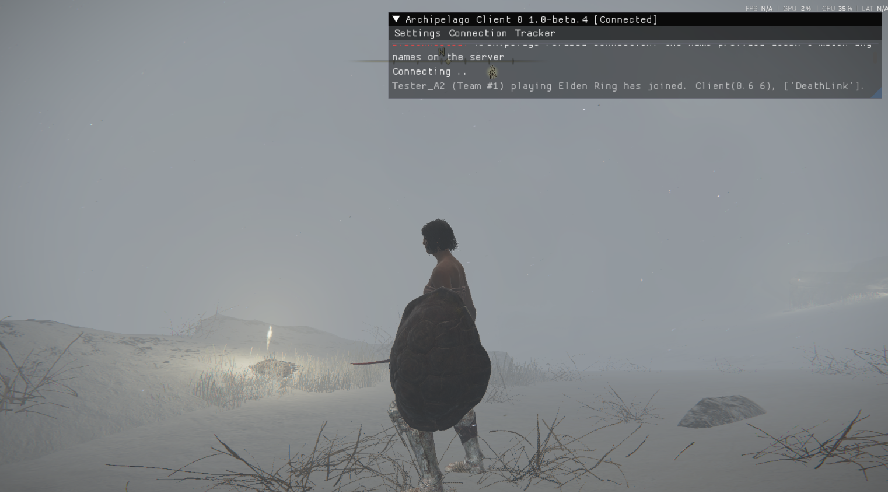

# Elden Ring Archipelago -- Setup

There are two jobs here, and you may only need one of them:

- **Every player** installs the client and launches the game with it. That is
  [Part 1](#part-1-install-the-client-every-player) and
  [Part 3](#part-3-connect-and-play).
- **Whoever hosts the game** also makes the seed. That is
  [Part 2](#part-2-make-the-seed-host-only). If someone else is hosting, skip it.

Playing solo? You are the host, so do all three.

New to Archipelago? It is a **multiworld** randomizer: one or more games are
shuffled together, so items you find can belong to someone else and theirs can
belong to you. Each player has a **slot**, described by a small settings file
called a **yaml**. Solo works the same way with one slot.

---

## What you need

- **Elden Ring** on PC (Steam), updated. Nothing in the game folder is changed:
  no `regulation.bin` edit, no patched files. The randomizer works entirely
  while the game runs.
- **Mod Engine 3 (me3)**, the mod loader. Free, installed once. See step 1.
- **The release zip** from the
  [Peliarch Downloads](https://peliarch.ca/downloads#elden-ring): the file
  named `ER-Archipelago-*.zip`. Use **the same version the host
  generated with**. If you are not sure, ask the host.
- **Archipelago 0.6.7**, only if you are the host. Download it from
  [archipelago.gg](https://archipelago.gg).

---

## Part 1: Install the client (every player)

### 1. Install me3

Download the Windows installer from me3's
[releases page](https://github.com/garyttierney/me3/releases) and run it.

That is all the me3 setup there is. **Do not add anything to me3's own Elden
Ring profile, and do not copy our files into me3's folder.** The release zip
brings its own ready-made profile (step 4), and that is the only one you use.

### 2. Download the release zip

On [Peliarch Downloads](https://peliarch.ca/downloads#elden-ring),
open the Elden Ring release and download the asset whose name starts with
**`ER-Archipelago-v`**.

Do not use a **Source code** download. It contains no game client.

If your browser or Windows Defender deletes the download as a virus, see
[Troubleshooting](TROUBLESHOOTING.md#the-download-is-deleted-as-a-virus).

### 3. Extract it

Right-click the zip and choose **Extract All...**. Opening the zip by
double-clicking only previews it, and nothing inside will work from there.

The Extract All window suggests a folder in Downloads named after the zip,
version and date included. Click **Browse...** (or edit the path in the box) and
pick a plain folder of your own instead, for example `C:\Games\ER-Archipelago`.
Two places to avoid: `C:\Program Files\`, and the Elden Ring game folder. The
client writes its log and settings beside itself, and those folders block that.
Keeping the version number out of the folder name makes later updates easier:
you just extract the next release over the same folder.

You get this:

```
C:\Games\ER-Archipelago\
  eldenring.apworld          <- for the host (Part 2)
  EldenRing.yaml             <- settings template (Part 2)
  SETUP.md, TROUBLESHOOTING.md, ...
  me3\                       <- the game client. Leave everything in here where it is.
    ap.me3                   <- the file you double-click to play
    eldenring_archipelago.dll
    check_lots_table.json
    shoplineup_flags.json
    MapForGoblins.dll, MapForGoblins.ini, ...
    apconfig.json
```

**Leave the `me3\` folder as it is.** The client DLL needs the two `.json`
files beside it. Moved on its own, every pickup pays out twice and shop checks
never register.

### 4. Launch the game: double-click `ap.me3`

Open the `me3\` folder and **double-click `ap.me3`**. me3 starts Elden Ring with
the Archipelago client loaded. You do not type anything into a command prompt.

A black **me3 console window** opens too and fills with log lines. That is
normal: it is me3 reporting what it loads. Leave it open while you play; it
closes with the game.

> **Windows hides file extensions by default**, so `ap.me3` is shown as just
> **`ap`**, with the me3 icon. That is the right file. (`apconfig.json` likewise
> shows as `apconfig`.)

Use `ap.me3` every time you play this seed. These all start the game **without**
Archipelago, and are the most common setup mistake:

- launching from Steam;
- the **"ELDEN RING (me3)"** shortcut the me3 installer adds to the Start menu
  or desktop. It runs me3's default profile, which does not include
  Archipelago;
- picking Elden Ring in the me3 window without choosing `ap.me3`;
- adding the `me3\` folder to me3's own Elden Ring profile.

If Windows asks **"How do you want to open this file?"** when you double-click
`ap.me3`, me3 is not installed. Close that box without picking an app (choosing
Notepad there would make every later double-click open Notepad), and go back to
step 1. If the console window flashes up and vanishes without starting the game,
make sure Steam is running and try again; if it keeps happening, see
[Troubleshooting](TROUBLESHOOTING.md#5-the-game-will-not-start-or-crashes).

### 5. Check that it loaded

When the client is running, an **Archipelago menu bar** is drawn over the game,
with entries such as **Connection** and **Tracker**. No menu bar means the
client did not load: you launched some other way than `ap.me3`, or the zip was
not extracted. See
[Troubleshooting](TROUBLESHOOTING.md#the-game-launches-vanilla-no-overlay).

Next, if you are the host, make the seed in Part 2. Otherwise go to
[Part 3](#part-3-connect-and-play).

---

## Part 2: Make the seed (host only)

### 1. Install the apworld

Double-click `eldenring.apworld` from the extracted folder, and Archipelago
installs it. Or copy it into `Archipelago\custom_worlds\` yourself. Either way
it should end up in `custom_worlds\`.

### 2. Make each player's yaml

The easy way is the **yaml builder** at <https://peliarch.ca/er/>. Pick
profiles for content, run length, combat and so on, adjust any option you like,
and download the finished file. It shows the seed size as you go. Nothing to
install.

To edit a file instead, copy `EldenRing.yaml` from the extracted folder and set
`name:` to the player's slot name. That is the only line you have to change; the
rest is a tuned solo run of **The Shattering**, base game only. Every option has
a comment beside it explaining it. Leave the `game: Elden Ring` line and the
`Elden Ring:` header as they are, and keep the options indented under it.

Put the yaml files in `Archipelago\Players\`.

> **About the DLC.** The shipped `EldenRing.yaml` and the builder's presets
> leave the DLC **off**. A yaml that never mentions `enable_dlc` turns it **on**,
> and 11 of the 28 regions then need Shadow of the Erdtree.

> **The builder can be ahead of your apworld.** <https://peliarch.ca/er/> follows
> the current release, and `/er/beta/` the build in progress. Archipelago does
> not stop on an option your installed apworld does not know: it warns and uses
> that option's default. If generation warns about unknown options, install the
> newest release.

### 3. Generate

In the Archipelago Launcher, click **Generate**. When it succeeds, an
`AP_<number>.zip` appears in `Archipelago\output\`.

### 4. Host it

- **Multiworld:** upload that zip at
  [archipelago.gg/uploads](https://archipelago.gg/uploads). The room page shows
  the **address and port** players connect to.
- **Solo:** you can do the same, or run **Host** from the Archipelago Launcher
  on the zip and connect to `localhost:38281`.

---

## Part 3: Connect and play

### 1. Connect

With the game running through `ap.me3`, open **Connection** in the Archipelago
menu bar and enter:

- **Server**: the address and port from the room page, for example
  `archipelago.gg:54321`. **Every archipelago.gg room has its own port**, shown
  on the room page. `38281` is only the default for a server you run yourself.
- **Slot**: your `name:` from the yaml.
- **Password**: only if the room has one.

Open the menu from a game menu rather than while moving, so your typing does not
leak into the game.

**This is what "it worked" looks like:** the window title reads
**[Connected]**, and the log says your slot joined, playing `Elden Ring`.



If it does not connect, see [Troubleshooting](TROUBLESHOOTING.md#6-connecting).
The usual causes are a wrong port, a room that went to sleep (reload its page
to wake it, and re-copy the port), or a firewall rule on `eldenring.exe`.

### 2. Start a new character

`ap.me3` keeps Archipelago in its own save file, `AP_me3.sl2`, separate from
your normal saves. The first time, me3 fills it with a **copy** of your normal
save, so your existing characters appear in the list. That is expected. Nothing
you do here touches your real save.

**Make a new character for the seed.** Do not load one of the copied ones while
connected: the client treats it as a fresh Archipelago character and may give it
the room's whole backlog of items.

### 3. Play

In **The Shattering** you start at Roundtable Hold with one region open. Each
region is opened by its **Lock**, an item someone (maybe you) finds. When a Lock
arrives, that region's graces light up and you fast-travel in.

**Locks are the only way into a region.** Vanilla routes and key items gate
nothing: no Rold Medallion for the Mountaintops, no Mohg fight for the DLC.
Walk into a region you do not hold the Lock for and you are warped back out. The
Player Guide (`Elden-Ring-Archipelago-Player-Guide.md`, in the zip) covers how a
run plays, including the two exceptions.

Received items show in the game's own item banner. Useful tools:

- **F6 / Tracker**: your checks by region, with locked regions dimmed and the
  item that opens them named.
- **Map**: pins for your seed's checks, coloured as you collect them (see
  [The map](#the-map-mapforgoblins) below).
- **Connection**: change server, slot or password at any time.
- **Stuck?** [GETTING-UNSTUCK.md](GETTING-UNSTUCK.md) explains the rescue
  console: warps, graces, and a goal that did not fire.

---

## Quick fixes

| What happens | Why, and the fix |
|---|---|
| Elden Ring starts, but no Archipelago menu bar | You did not launch with `ap.me3`, or the zip is not extracted. Extract it, then double-click `ap.me3` in the `me3\` folder. |
| I can't find the DLL, or the folder has thousands of files | You downloaded **Source code**. Get the `ER-Archipelago-v...` zip. |
| Windows asks which app should open `ap.me3` | me3 is not installed. Close the box without choosing an app, and install me3. |
| I launched "ELDEN RING (me3)" and got a normal game | That shortcut is me3's default profile. Double-click `ap.me3` instead. |
| Every pickup also gives the normal item; shop purchases do not count | The DLL was moved away from its two `.json` files. Use the `me3\` folder exactly as extracted. |
| `VERSION MISMATCH` in the client log | Your client and the host's apworld are from different releases. Download the release the host used. |
| Generation says `No world found to handle game EldenRing` | A very old (v0.1) yaml. The game is now `Elden Ring`, with a space. Start a fresh yaml from the template or the builder. |
| The seed ignores options I set | An old yaml with retired option names. The generation log names each one it dropped. Start a fresh yaml. |
| Checks send, but nothing ever arrives | `RandomizerHelper.dll` is loaded. Remove it. |

Everything else, sorted by symptom: [TROUBLESHOOTING.md](TROUBLESHOOTING.md).
When you ask for help, bring your yaml, the spoiler log and the client log.

---

## Also using thefifthmatt's randomizer?

You can stack it for randomized enemies and starting class, with **its item
randomization turned off**: items are ours. This is a different launch path:
you launch from Matt's app, not from `ap.me3`, and it puts the Archipelago
character in your normal save. Follow
[ENEMY-AND-STARTING-CLASS-RANDOMIZATION.md](ENEMY-AND-STARTING-CLASS-RANDOMIZATION.md)
step by step.

---

## Reference

### What else is in the zip

| File | What it is |
|---|---|
| `eldenring.apworld` | The Archipelago world. The host installs it (Part 2). |
| `me3\` | The client, its profile `ap.me3`, its data tables, the MapForGoblins map engine (licence in `MFG-LICENSE.txt`), and the updater. |
| `EldenRing.yaml` | Settings template. |
| `screenshots/`, `SCREENSHOTS.md` | The images these docs show. |
| `TROUBLESHOOTING.md` | Problems sorted by symptom. |
| `KNOWN-ISSUES.md` | Known issues and by-design behaviour. Read it before filing a report. |
| `Elden-Ring-Archipelago-Player-Guide.md` | How a run plays. |
| `GETTING-UNSTUCK.md` | The rescue console. |
| `ENEMY-AND-STARTING-CLASS-RANDOMIZATION.md` | Stacking thefifthmatt's randomizer. |
| `CHANGELOG.md` | What changed in each release. |
| `ATTRIBUTION.md`, `PROVENANCE.md`, `DISTRIBUTION.md`, `LICENSE` | Credits, provenance and licence. |

The zip also carries release notes and build-identity files. An offline copy of
the yaml builder, `er-options-wizard.html`, is a separate download on the same
release page.

### Updating

**The updater** keeps your `apconfig.json` and map settings
(`MapForGoblins.ini`). It needs Python 3 installed
([python.org](https://www.python.org/downloads/), tick **Add python.exe to
PATH**; see [Troubleshooting](TROUBLESHOOTING.md#2-running-the-bundled-ps1-scripts)
if it complains). With the game closed, run it from your `me3\` folder:

```powershell
powershell -ExecutionPolicy Bypass -File .\update-er-archipelago.ps1
```

**By hand:** extract the new zip over the same folder. This **overwrites**
`apconfig.json` and `MapForGoblins.ini` with fresh copies, so back them up first
and put them back afterwards, or just re-enter your connection in-game.

Do not update the client in the middle of a seed unless
the release notes say it still accepts your seed. Details in
[Troubleshooting](TROUBLESHOOTING.md#3-updating-the-client).

### Launching from a command line

Double-clicking `ap.me3` does the same as:

```powershell
me3 launch --profile "C:\Games\ER-Archipelago\me3\ap.me3"
```

### Using other mods

me3 loads only what `ap.me3` lists. To add a mod such as Seamless Co-op, add it
to `ap.me3` itself, not to a second profile. See
[Troubleshooting](TROUBLESHOOTING.md#8-saves-seamless-co-op-and-other-mods).
Mods that rewrite item lots or params are not supported.

### The map (MapForGoblins)

`ap.me3` loads the MapForGoblins map engine alongside the client. Connect and
open the map: pins for your seed's checks and their colouring start
automatically. Yellow rings mark known hints. By default only checks in regions
you can currently reach are pinned.

Press **F10 → Archipelago** to change that:

| Setting | Default | Effect |
| --- | --- | --- |
| Checks only | On | Hide pins without a match in your connected seed. |
| Progression only | Off | Show progression targets, including granting bosses instead of sweep pickups. |
| In logic only | On | Show only checks whose tracker region is reachable. |

"In logic" uses region access only, not quest, key or puzzle requirements. A
check with no map pin is still a real check; F6 lists every one. When an enabled
boss sweep grants a pickup, the map highlights the boss instead. Turning a
category back on takes effect the next time you open the map.

F6 → **Map integration** has session opt-outs for sharing and colouring; they
reset on the next launch, while F10 settings are saved in `MapForGoblins.ini`
(updates keep your copy). To turn the map engine off, close the game and remove
only its `[[natives]]` entry from `ap.me3`.

### Item icons

This bundle does not include the optional AP Flower icon package or its installer.
Foreign Archipelago items may show the vanilla Telescope icon; read the item
name (`AP: <item>`) to identify them. The icon does not change the item or check.
If an older install has Flower menu files, those files are separate from this
release and should be managed with the tool that installed them.

### Run variants

The shipped template is the recommended run. Some options worth knowing:

- **Length:** `num_regions: 6` (shipped) keeps six regions. `0` keeps all of
  them: 17 in the base game, 28 with the DLC. Try `4` for a short evening.
- **Boss sweeps:** `dungeon_sweep: bosses` (shipped) lets defeated bosses collect
  eligible checks in their areas. `minidungeons` narrows the sweeps; `none`
  leaves every check for you to collect at its original spot. `region_sweep`
  extends eligible sweeps to a wider region after a major boss.
- **Bingo:** `bingo_mode: true` builds an experimental objective board with its
  own win condition and region selection. Start a fresh character with the
  matching client. Some squares track automatically; others need manual marks.
  See the [bingo guide](../Elden-Ring-Archipelago-Player-Guide.md#bingo-which-goals-are-automatic).
- **Which regions:** `num_regions_order: rolled` (default) picks at random;
  `vanilla_order` takes the first N along the region spine. Your starting region
  is drawn separately either way.
- **Goal:** `ending_condition: great_runes` with `goal_great_runes: N`.
- **DeathLink:** `death_link: true`.
- **DLC:** `enable_dlc: true` adds the Land of Shadow regions; `dlc_only: true`
  plays only those. DLC regions open by Lock like any other, with no Mohg fight.
  The base game is the better-tested path; see `KNOWN-ISSUES.md`.

### Archipelago version

This release is built and tested against **Archipelago 0.6.7**. The apworld
accepts 0.6.6 and players report it working there, but if anything looks wrong,
move to 0.6.7 before reporting it.

### Optional Mario mode (v0.6.4)

For a Mario-mode seed, download `ER-Mario-AP-v0.6.4.zip` from the same release as
this AP client bundle and follow the companion's README. It includes the paired
profile generator and local icon-composition tool; you need your own US SM64 ROM.
Mario mode is experimental and off by default. See `KNOWN-ISSUES.md` for the live
verification limits. The ordinary profile described above remains available.

#### Health and power upgrades (development builds)

To include progressive stats, generate a new seed with both `mario_mode: true`
and `mario_stat_upgrades: true`. Four Progressive Health items raise capacity
from four to eight wedges. Three Progressive Power items raise damage from
75% through 100% and 125% to 150% of normal Mario damage. Increasing capacity
does not heal current damage; healing and respawn respect the unlocked maximum.

This needs the paired development AP client and a Mario DLL supporting
`mario_stats_v1`; the released v0.6.4 companion does not support stat upgrades.
Use a dedicated Mario save and the same paired profile setup. Existing seeds
cannot acquire the new item families by replacing DLLs. The setting defaults
off, preserving existing Mario health and damage when omitted.

#### Optional FLUDD nozzles and tanks (development)

Generate a new seed with `mario_mode: true` and `mario_fludd: true`. Hover,
Rocket and Turbo start locked; each has one useful nozzle item. Three useful
Progressive FLUDD Tanks increase capacity from 60 to 80, 100, then 120 units.
Tank receipts never refill water. Squirt is unfinished and has no unlock item.
The six items replace filler and never gate checks or goals.

Use compatible paired development AP client and Mario DLLs supporting
`mario_fludd_v1`, with your own SM64 ROM and dedicated Mario save/profile.
Existing seeds cannot gain FLUDD items retroactively. The advanced option defaults
off, preserving existing seed pools and payloads. Stat upgrades remain a separate
optional setting. No live FLUDD playthrough test is claimed.

Hold **RB** to use the selected nozzle; while holding RB, D-pad Up selects Hover,
Down selects Rocket, Right selects Turbo, and Left cycles unlocked nozzles.
On keyboard, hold **J** to use FLUDD and press **I** to cycle. Rocket charges for
one second; Turbo charges for two thirds of a second. Water regenerates while
Mario stands still with FLUDD released, and refills at a grace or respawn.
The new DLL rebuilds Mario's local armour package for the backpack; restart after
the setup finishes so me3 can load it. Keep the generated package and your ROM.

#### Optional Cappy and Sonic movement (development)

For a new Mario seed, enable either advanced option independently:

```yaml
mario_mode: true
mario_cappy: true
mario_sonic_movement: true
```

Cappy adds two useful items, Cap Throw and Cap Bounce. Both start locked; a bounce
needs a deployed cap, so receive Cap Throw before using it. This first version
has no enemy capture or cap damage. Sonic movement adds useful Spin Dash, Drop
Dash and Air Dash items; all three start locked. Homing is not included.

Each enabled option replaces filler with its items and adds no check or goal
requirements. Cappy, Sonic movement, FLUDD and stat upgrades can be combined.
Both options default off and preserve existing seed pools and payloads. Existing
seeds cannot gain these items retroactively. Use a new seed and compatible paired
Mario/AP client DLLs supporting `mario_cappy_v1` and/or
`mario_sonic_movement_v1`, with your own SM64 ROM and dedicated Mario profile.
These movement additions are experimental; no live playthrough is claimed.
